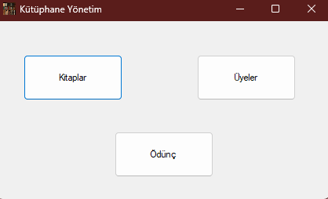
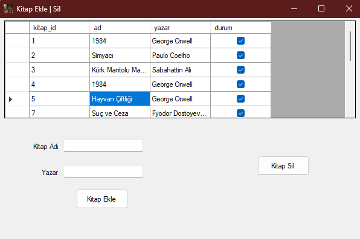
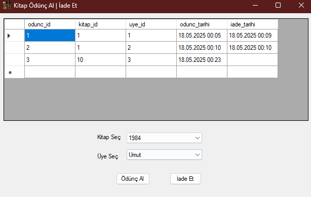
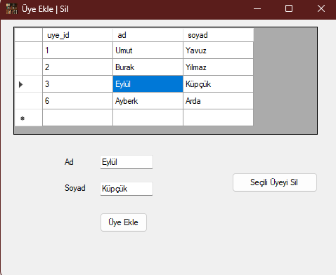

# Library Management System

A Windows Forms library management application built with .NET 10 and SQL Server. It tracks books,
members and loans (lend / return with dates).

Türkçe için: [README.tr.md](README.tr.md)

## Features

- **Books**: list, add and delete books.
- **Members**: list, add and delete members.
- **Loans**: lend a book to a member, take it back, and see loan and return dates.
- Business rules: a book cannot be lent to two members at the same time; a book or member with an
  open loan (or loan history) cannot be deleted.

## Architecture

```
src/
  KutuphaneYonetim.Domain    Entities and repository contracts
  KutuphaneYonetim.Business  BookService, MemberService, LoanService (business rules)
  KutuphaneYonetim.Data      EF Core DbContext, entity configurations, migrations, repositories
  KutuphaneYonetim.UI        WinForms screens; Program.cs is the composition root (DI)
```

- Data access uses EF Core (SQL Server provider); all database access is asynchronous and parameterised.
- The provider is configured through DI (`AddDataAccess`), so tests can use SQLite in-memory.
- On startup the application applies pending EF Core migrations and creates the database if needed.
- Unhandled errors are caught globally and shown to the user as a short message.

## Requirements

- .NET 10 SDK (Windows)
- SQL Server (Express or LocalDB is enough)

## Setup

1. Provide a connection string. Any of the following works (later ones override earlier ones):
   - Copy `src/KutuphaneYonetim.UI/appsettings.example.json` to `appsettings.json` in the same
     folder and edit `ConnectionStrings:Kutuphane`. `appsettings.json` is git-ignored.
   - User secrets:
     `dotnet user-secrets set "ConnectionStrings:Kutuphane" "<connection string>" --project src/KutuphaneYonetim.UI`
   - Environment variable `KUTUPHANE_CONNECTION`.
2. Build and run:
   ```
   dotnet build -c Release
   dotnet run --project src/KutuphaneYonetim.UI
   ```
   The database and its sample data are created on first start.

## Migrations

```
dotnet tool restore
dotnet ef migrations list --project src/KutuphaneYonetim.Data
dotnet ef migrations add <Name> --project src/KutuphaneYonetim.Data --output-dir Persistence/Migrations
```

The design-time factory reads `KUTUPHANE_CONNECTION` and otherwise uses a local SQL Server Express instance.

## Screenshots

| Main menu | Books |
| --- | --- |
|  |  |

| Loans | Members |
| --- | --- |
|  |  |

## License

Free for personal and educational use. Commercial use is not permitted.
