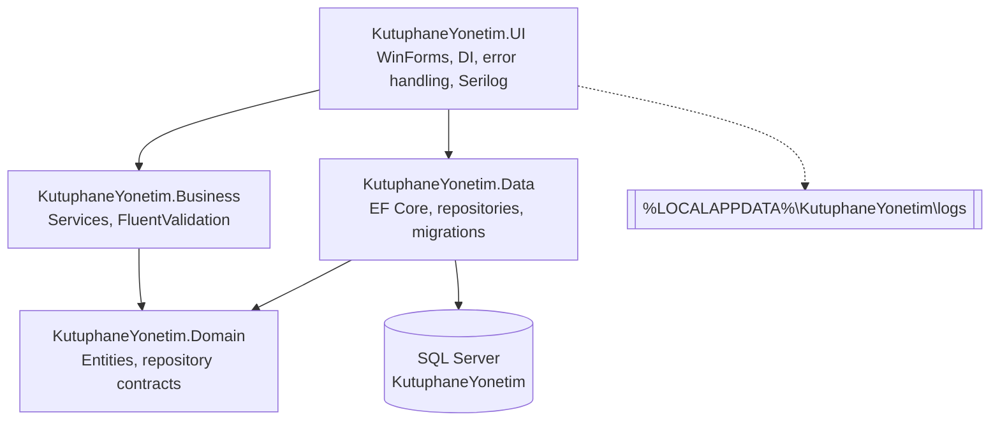
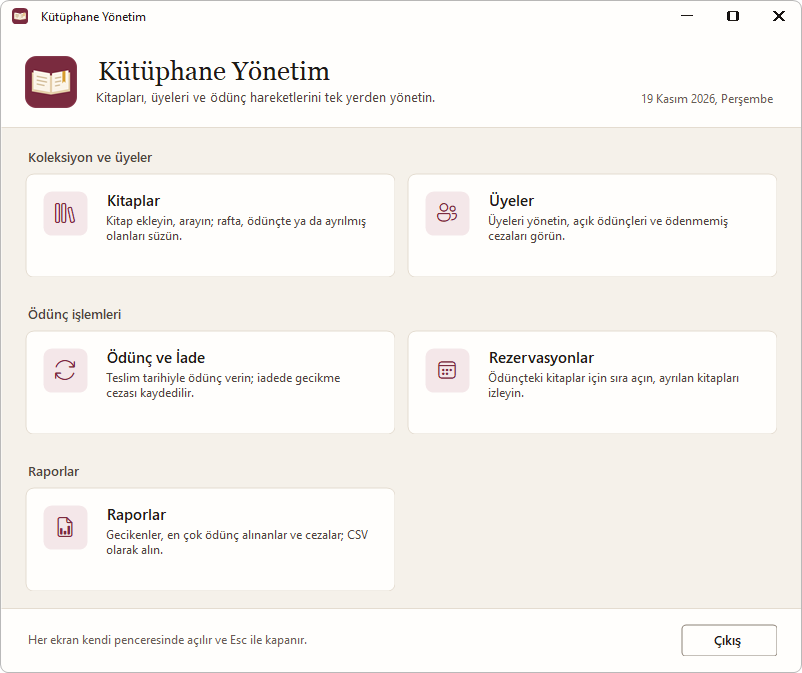
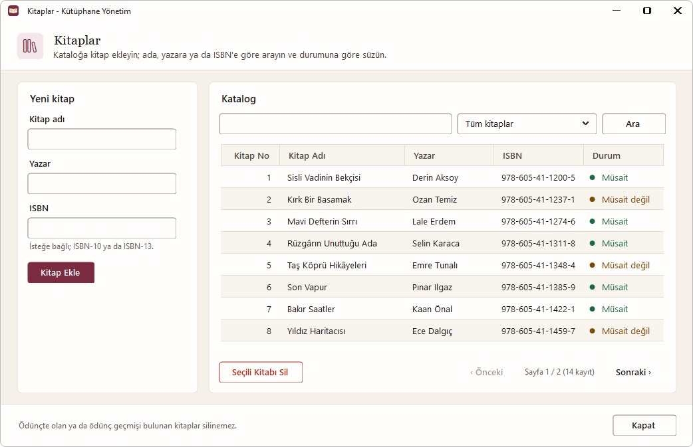
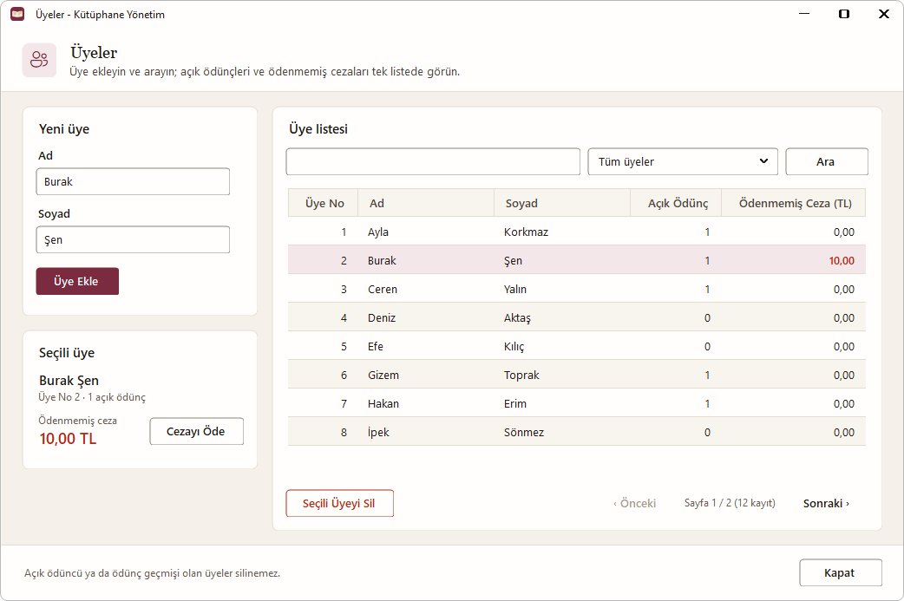
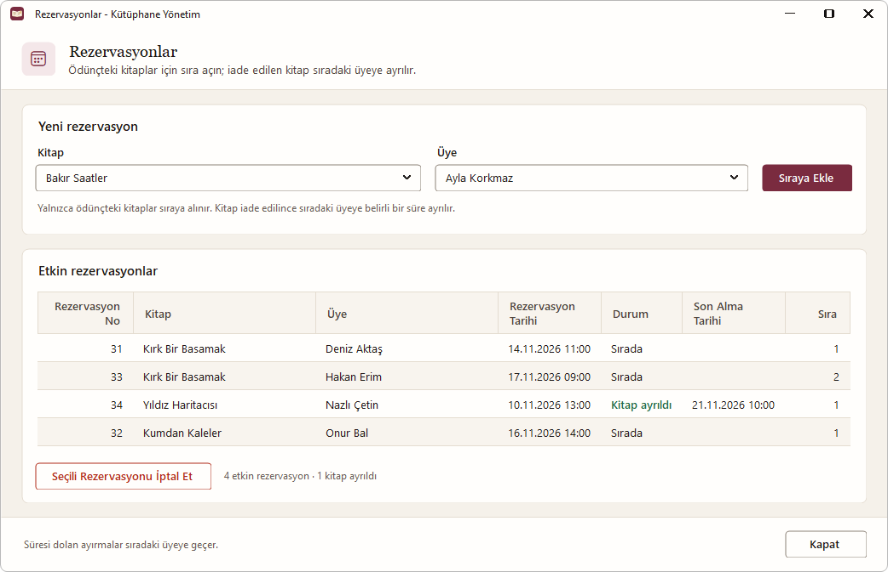

# 📚 Kütüphane Yönetim - Library Management System (C# & SQL Server)

🇬🇧 **English** · 🇹🇷 [Türkçe](README.tr.md)

A Windows Forms library management application built with .NET 10 and SQL Server. It tracks books,
members and loans (with due dates and late return fines), keeps a reservation queue for books on loan and
produces reports that can be exported to CSV. The code is split into Domain, Business, Data and UI
layers; database access uses EF Core, and the database is created and migrated automatically on startup.

> The application's user interface is in Turkish. Screen and button names below are given with their
> Turkish labels followed by an English translation, e.g. "Ödünç" (Loans).

---

## 📦 Features

- ✅ **Books** ("Kitaplar"): list, add and delete books on the "Kitap Ekle | Sil" (Add | Delete Book) screen, with an
  optional ISBN. Search by title, author or ISBN and filter by "Müsait" (available), "Ödünçte" (on loan) or
  "Rezervasyon için ayrılmış" (held for a reservation); the list is paged.
- ✅ **Members** ("Üyeler"): list, add and delete members on the "Üye Ekle | Sil" (Add | Delete Member) screen. Search
  by name, filter members with unpaid fines or open loans, see each member's open loans and unpaid fines and record
  a payment ("Cezayı Öde", Pay fine).
- ✅ **Loans** ("Ödünç"): lend a book to a member ("Ödünç Al", Lend) with a due date ("Teslim Tarihi"; suggested from
  the configured loan period), take it back ("İade Et", Return), and see loan, due and return dates, overdue days
  and fines on the "Kitap Ödünç Al | İade Et" (Lend | Return Book) screen.
- ✅ **Late fines**: a book returned after its due date gets a fine of a configurable amount per day. A member whose
  unpaid fines exceed a configurable threshold cannot borrow until the fines are paid.
- ✅ **Reservations** ("Rezervasyonlar"): members queue for a book that is on loan. When it comes back it is held for
  the first member in the queue for a configurable number of days and only that member can borrow it; a hold that
  is not picked up in time expires and the next member is served. A member can have one active reservation per book.
- ✅ **Reports** ("Raporlar"): overdue books, most borrowed books in a date range and unpaid fines. The table shown on
  screen is exported to CSV ("CSV Dışa Aktar", Export CSV): UTF-8 with BOM, `;` as separator, and cells that a
  spreadsheet would run as a formula are neutralised.
- ✅ **Business rules**: a book cannot be lent to two members at the same time (checked in a transaction and
  enforced by a filtered unique index); a book or member with an open loan, or with loan or reservation history,
  cannot be deleted.
- ✅ **Input validation**: titles, authors and names are trimmed and must be present and within the column
  length (100 characters for books, 50 for member names); an ISBN must be a valid ISBN-10 or ISBN-13. The rules
  live in central FluentValidation validators.
- ✅ **Automatic database setup**: pending EF Core migrations are applied on startup; a database created by the
  original application is upgraded in place and keeps its data.
- ✅ **Error handling and logging**: unexpected errors are caught globally and shown as short Turkish messages;
  technical details go to a daily log file only.

---

## 🧰 Tech Stack

| Area | Used |
|---|---|
| Platform | .NET 10 (`net10.0-windows` UI, `net10.0` libraries) |
| UI | Windows Forms |
| Data access | Entity Framework Core 10 (SQL Server provider) |
| Database | Microsoft SQL Server (Express or LocalDB is enough) |
| Validation | FluentValidation |
| Configuration / DI | Microsoft.Extensions.Configuration (JSON, user secrets, environment), Microsoft.Extensions.DependencyInjection |
| Logging | Serilog (file sink, daily rolling) |
| Testing | xUnit v3, Moq, EF Core SQLite (in-memory), optional real SQL Server test |
| CI | GitHub Actions (`.github/workflows/ci.yml`) |

---

## 🗂️ Project Structure

```text
KutuphaneYonetim/
├── src/
│   ├── KutuphaneYonetim.Domain/     # Entities (Book, Member, Loan, Reservation), read models, queries, repository contracts
│   ├── KutuphaneYonetim.Business/   # Services/ (books, members, loans, reservations), Reports/ (reports, CSV), Validation/
│   ├── KutuphaneYonetim.Data/       # EF Core DbContext, configurations, Migrations/, legacy upgrade, repositories
│   └── KutuphaneYonetim.UI/         # WinForms screens, Infrastructure/ (errors, logging), Program.cs (composition root)
├── tests/
│   ├── KutuphaneYonetim.Business.Tests/  # Service and validator unit tests (Moq)
│   ├── KutuphaneYonetim.Data.Tests/      # Repository and service tests on SQLite, legacy upgrade test (SQL Server)
│   └── KutuphaneYonetim.UI.Tests/        # Configuration, error message and log sanitising tests
├── docs/THREAT_MODEL.md             # Threat model
├── .github/workflows/ci.yml         # Build, test and release workflow
├── screenshots/                     # README screenshots
├── CHANGELOG.md
└── KutuphaneYonetim.sln
```



The UI references Data only to register dependencies at startup; forms work through the Business services.
All database access is asynchronous and parameterised. The provider is configured through DI (`AddDataAccess`),
so tests can use SQLite in-memory.

---

## 🛠️ Setup and Usage

### Requirements

- .NET 10 SDK (Windows)
- SQL Server (Express or LocalDB is enough)

### 1. Configuration

Provide a connection string named `Kutuphane`. Any of the following works (later ones override earlier ones):

1. **`appsettings.json`**: copy `src/KutuphaneYonetim.UI/appsettings.example.json` to `appsettings.json` in the
   same folder and edit `ConnectionStrings:Kutuphane`. `appsettings.json` is git-ignored.

   ```json
   {
     "ConnectionStrings": {
       "Kutuphane": "Server=localhost\\SQLEXPRESS;Database=KutuphaneYonetim;Trusted_Connection=True;TrustServerCertificate=True;"
     },
     "Library": {
       "LoanPeriodDays": 14,
       "DailyFine": 2.50,
       "MaxUnpaidFine": 0,
       "ReservationHoldDays": 3
     }
   }
   ```

2. **User secrets**:

   ```powershell
   dotnet user-secrets set "ConnectionStrings:Kutuphane" "<connection string>" --project src/KutuphaneYonetim.UI
   ```

3. **Environment variable** `ConnectionStrings__Kutuphane`.
4. **Environment variable** `KUTUPHANE_CONNECTION` (highest priority).

> Inside JSON the `\` in `localhost\SQLEXPRESS` is written as `\\`. `TrustServerCertificate=True` is meant for a
> local development server only.

If no connection string is found, the application shows a Turkish message explaining these options and exits.

The optional `Library` section sets the lending rules (missing values use the defaults shown above). Invalid values
stop the application at startup with a Turkish message.

| Setting | Default | Meaning |
|---|---|---|
| `LoanPeriodDays` | 14 | Suggested loan period when lending (1-365 days) |
| `DailyFine` | 2.50 | Fine per day a book is returned late |
| `MaxUnpaidFine` | 0 | Largest unpaid fine total with which a member may still borrow (0: any unpaid fine blocks) |
| `ReservationHoldDays` | 3 | How long a returned book is held for the first member in its reservation queue (1-30 days) |

### 2. Running

```powershell
dotnet build -c Release
dotnet run --project src/KutuphaneYonetim.UI
```

The database is created on first start and filled with sample data; pending migrations are applied
automatically on every start, so no manual `dotnet ef database update` is needed.

### 3. Migrations

```powershell
dotnet tool restore
dotnet ef migrations list --project src/KutuphaneYonetim.Data
dotnet ef migrations add <Name> --project src/KutuphaneYonetim.Data --output-dir Persistence/Migrations
```

The design-time factory reads `KUTUPHANE_CONNECTION` and otherwise uses a local SQL Server Express instance.

### 4. Logs

Logs are written to `%LOCALAPPDATA%\KutuphaneYonetim\logs\kutuphane-YYYYMMDD.log`, one file per day, and the
last 30 files are kept. The folder is outside the repository. Exception messages are not logged (they can
contain values typed by the user); only exception types, error codes and stack traces are. Member names and
other personal data are never written to the log.

---

## 🔐 Security

See [docs/THREAT_MODEL.md](docs/THREAT_MODEL.md) for the threat model.

- Connection strings are kept out of the repository (`appsettings.json` is ignored; user secrets and environment
  variables are supported).
- All queries go through EF Core; there is no hand-built SQL with user input.
- Business rules are enforced in the Business layer and backed by database constraints (foreign keys with
  restrict, check constraint on return date, filtered unique index on open loans).
- Users only see Turkish messages; raw exception text is never shown.
- CSV exports neutralise cells that start with `=`, `+`, `-`, `@`, tab or carriage return (prefixed with `'`), so
  data typed into the application cannot run as a spreadsheet formula. The file is written to a temporary file in
  the target folder and then moved over the target.
- The application has no sign-in or roles: anyone who can start it can change all data. Database access
  is controlled by the SQL Server account in the connection string.

---

## 🖥️ Screenshots

The images are drawn offscreen with invented data by `dotnet run --project tools/Screenshots` (no window
is opened); select an image for its 2x version.

| "Kütüphane Yönetim" (Main menu) | "Kitaplar" (Books) |
| --- | --- |
| [](screenshots/ana-sayfa-2x.png) | [](screenshots/kitaplar-2x.png) |

| "Üyeler" (Members) | "Ödünç ve İade" (Loans and returns) |
| --- | --- |
| [](screenshots/uyeler-2x.png) | [](screenshots/odunc-iade-2x.png) |

| "Rezervasyonlar" (Reservations) | "Raporlar" (Reports) |
| --- | --- |
| [](screenshots/rezervasyonlar-2x.png) | [](screenshots/raporlar-2x.png) |

| "Onay" (Confirmation) |
| --- |
| [](screenshots/onay-penceresi-2x.png) |

---

## 🧪 Testing

### Manual testing

1. Add and delete a book on "Kitaplar" (Books); try adding one with an empty title.
2. Add and delete a member on "Üyeler" (Members).
3. On "Ödünç" (Loans), lend a book and return it; check the dates in the grid. Lend a book with today as the due
   date, change the system date (or use a small `LoanPeriodDays`) and return it late: the fine is shown and
   recorded, and the member cannot borrow again until the fine is paid on "Üyeler" (Members).
4. Try to lend the same book twice, and to delete a member who has not returned a book: both are refused with a warning.
5. On "Rezervasyonlar" (Reservations), reserve a book that is on loan for two members, return it and check that only
   the first member can borrow it.
6. Search and filter on "Kitaplar" and "Üyeler"; on "Raporlar" (Reports), show each report and export it to CSV.
7. Stop SQL Server and check that a friendly Turkish error is shown and the details land in the log file.

### Automated tests

```powershell
dotnet test -c Release
```

| Project | Type | Scope | Result (`-c Release`) |
|---|---|---|---|
| `tests/KutuphaneYonetim.Business.Tests` | Unit | Lending conflicts, due dates, fine calculation and threshold, reservation rules, search normalisation, reports, CSV escaping and file replacement, validation (xUnit + Moq) | 163 passed |
| `tests/KutuphaneYonetim.Data.Tests` | Integration | Repositories and services on SQLite in-memory (`Data Source=:memory:`): fines, search and paging, reservation queue and holds, reports and CSV; legacy database upgrade on SQL Server | 52 passed, 2 skipped |
| `tests/KutuphaneYonetim.UI.Tests` | Unit | Example configuration and Library settings, Turkish error messages, log sanitising, screen layout (forms built without being shown) | 22 passed |

The skipped tests need SQL Server. They use a throw-away database on the server in `KUTUPHANE_TEST_SQLSERVER`
(default: local SQL Express with Windows authentication) and are skipped when `KUTUPHANE_SKIP_SQL_TESTS=1` is set
or no server is reachable. The temporary databases are dropped afterwards. The first rebuilds the original schema
by script; the second restores a real backup of the original database and runs only when `KUTUPHANE_LEGACY_BACKUP`
points to such a `.bak` file that the SQL Server service can read.

On SQLite the schema is created from the model (`EnsureCreated`) instead of migrations, and row versions are
not generated. The SQL Server test only verifies that the filtered unique index rejects a second open loan for
the same book; concurrent races are not exercised by any test.

---

## 🚀 CI and Release

`.github/workflows/ci.yml` runs on pushes to `main`, on pull requests and on `v*` tags (Windows, .NET 10):

1. **Build:** `dotnet build -c Release`
2. **Test:** `dotnet test -c Release` (SQL Server test skipped)
3. **Release (only on `v*` tags):** a framework-dependent win-x64 build is published and uploaded as the
   workflow artifact `KutuphaneYonetim-<tag>-win-x64.zip`

To produce the same build locally:

```powershell
dotnet publish src/KutuphaneYonetim.UI -c Release -r win-x64 --self-contained false -o ./publish
```

The target machine needs the .NET 10 Desktop Runtime. Put `appsettings.json` next to `KutuphaneYonetim.exe`
or set `KUTUPHANE_CONNECTION`.

---

## 👨‍💻 Developer Notes

- See [CHANGELOG.md](CHANGELOG.md) for the version history.
- `Program.cs` is the composition root: configuration, DI, logging and the global `ThreadException` /
  `UnhandledException` handlers are set up there.
- Business rule violations raise `BusinessRuleException` with a Turkish message, which the UI shows as a warning.
- Validators (`BookInputValidator`, `MemberInputValidator`, `LoanInputValidator`, `LibraryPolicyValidator`) live in
  `KutuphaneYonetim.Business/Validation` and stop at the first failure, so the user sees one message at a time.
- Lending rules come from `LibraryPolicy` (the `Library` settings section), passed to `AddBusinessServices`.
- Due dates, fines and reservations were added by later migrations with nullable columns and a new table, so a
  database created by the original application is upgraded in place first and then migrated like any other.

---

## 🧳 License

Released under the [MIT License](LICENSE).
