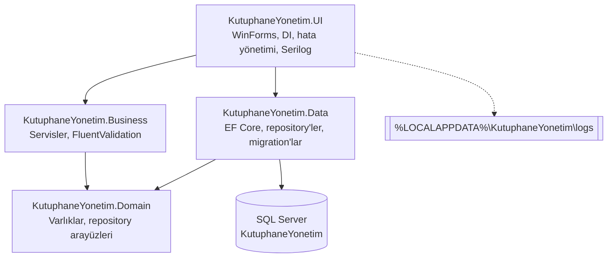
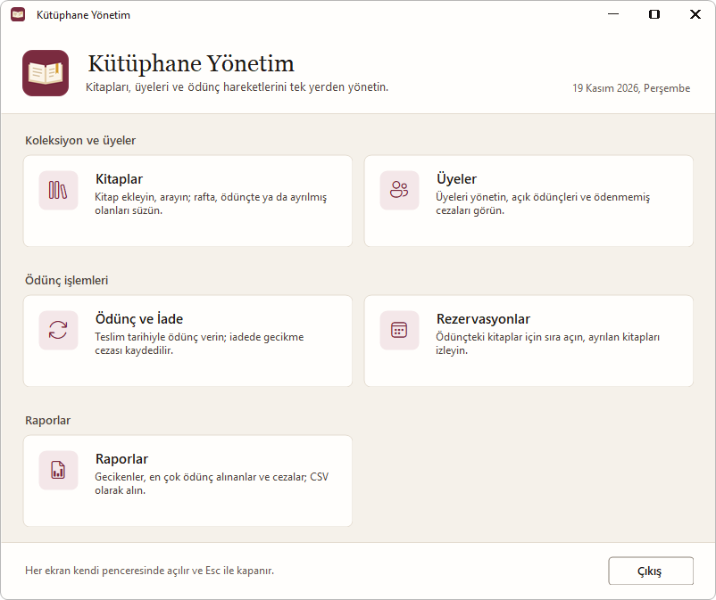
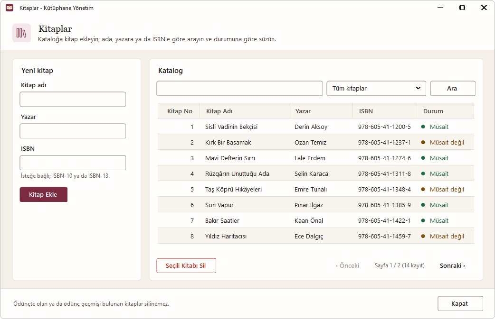
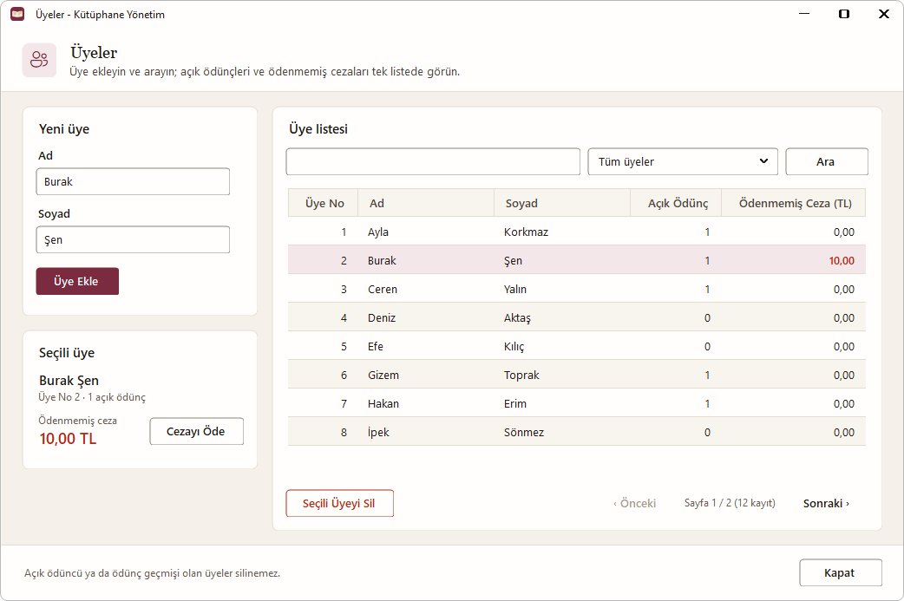
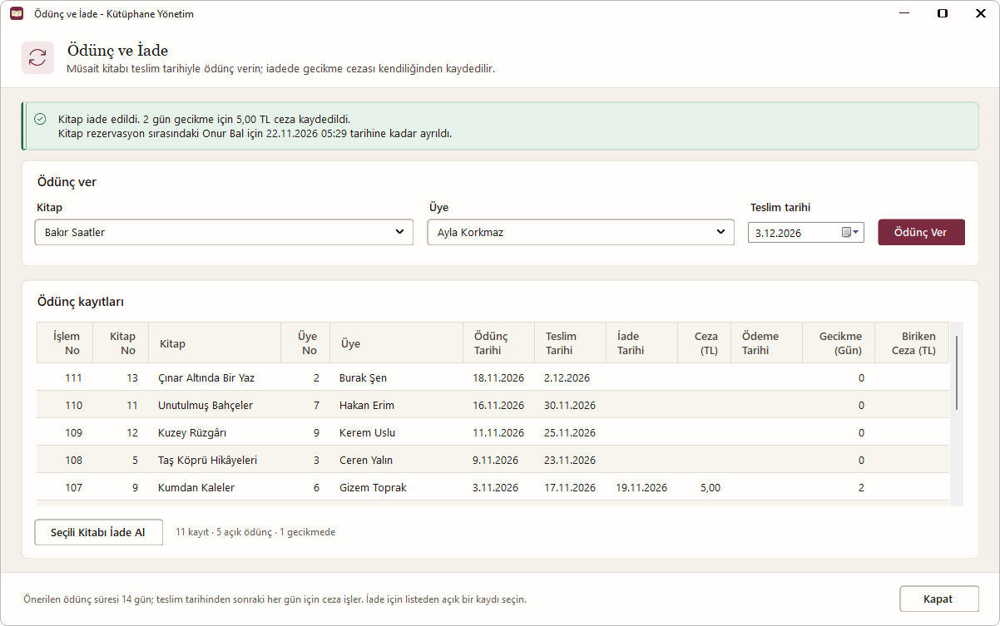
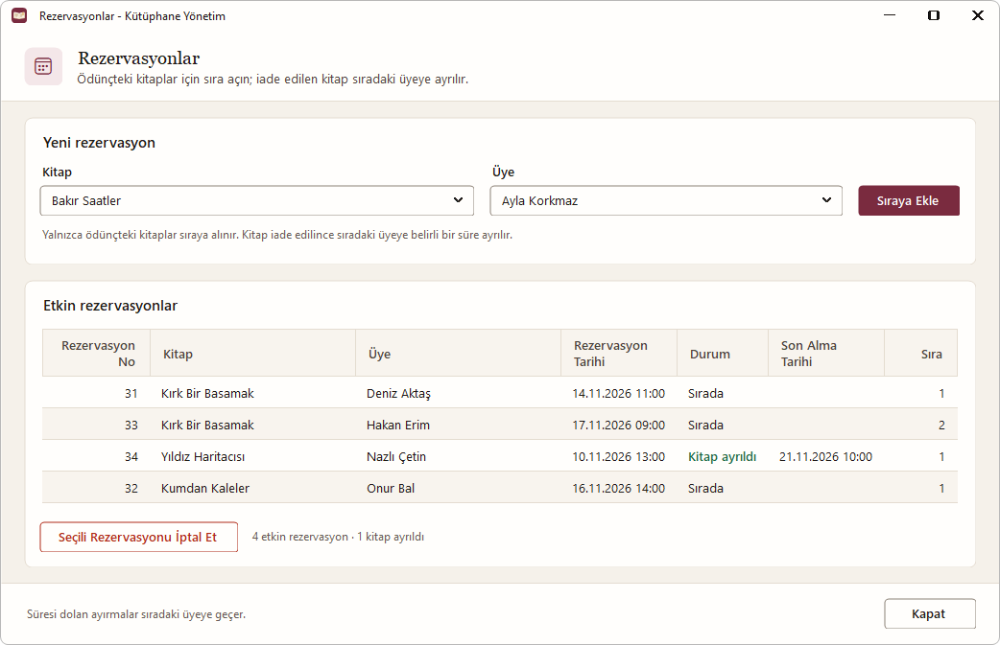
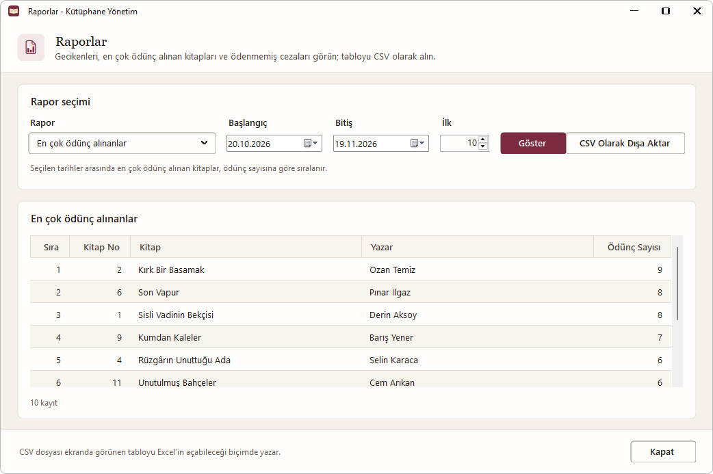
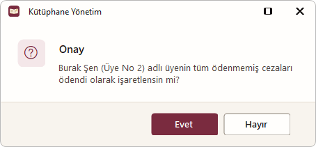

# 📚 Kütüphane Yönetim - Kütüphane Yönetim Sistemi (C# & SQL Server)

🇬🇧 [English](README.md) · 🇹🇷 **Türkçe**

.NET 10 ve SQL Server ile geliştirilmiş bir Windows Forms kütüphane yönetim uygulaması. Kitapları, üyeleri ve
ödünç işlemlerini (teslim tarihi ve gecikme cezasıyla) takip eder, ödünçteki kitaplar için rezervasyon sırası tutar
ve CSV'ye aktarılabilen raporlar üretir. Kod Domain, Business, Data ve UI
katmanlarına ayrılmıştır; veri erişimi EF Core ile yapılır, veritabanı açılışta otomatik olarak oluşturulur ve güncellenir.

> Uygulamanın arayüzü Türkçedir. Aşağıda ekran ve düğme adları Türkçe etiketiyle, yanında İngilizce karşılığıyla
> verilmiştir, örneğin "Ödünç" (Loans).

---

## 📦 Özellikler

- ✅ **Kitaplar** ("Kitaplar"): "Kitap Ekle | Sil" (Add | Delete Book) ekranında isteğe bağlı ISBN ile kitap
  listeleme, ekleme ve silme. Ad, yazar veya ISBN ile arama; "Müsait", "Ödünçte" ve "Rezervasyon için ayrılmış"
  filtreleri; sayfalı liste.
- ✅ **Üyeler** ("Üyeler"): "Üye Ekle | Sil" (Add | Delete Member) ekranında üye listeleme, ekleme ve silme. Ada göre
  arama, ödenmemiş cezası ya da açık ödüncü olanları süzme, her üyenin açık ödünç sayısını ve ödenmemiş cezasını
  görme ve ödemeyi kaydetme ("Cezayı Öde").
- ✅ **Ödünç** ("Ödünç"): "Kitap Ödünç Al | İade Et" (Lend | Return Book) ekranında üyeye teslim tarihiyle
  ("Teslim Tarihi"; ayarlanan ödünç süresinden önerilir) kitap ödünç verme ("Ödünç Al", Lend), iade alma
  ("İade Et", Return); ödünç, teslim ve iade tarihlerini, gecikme gününü ve cezayı görme.
- ✅ **Gecikme cezası**: teslim tarihinden sonra iade edilen kitap için gün başına ayarlanabilir tutarda ceza
  kaydedilir. Ödenmemiş cezası ayarlanan eşiği aşan üye, ceza ödenene kadar yeni kitap alamaz.
- ✅ **Rezervasyon** ("Rezervasyonlar"): üyeler ödünçteki bir kitap için sıraya girer. Kitap iade edilince
  sıradaki ilk üye için ayarlanabilir gün kadar ayrılır ve yalnızca o üye ödünç alabilir; süresinde alınmayan
  rezervasyon düşer ve sıradaki üyeye geçilir. Bir üyenin aynı kitap için tek aktif rezervasyonu olabilir.
- ✅ **Raporlar** ("Raporlar"): geciken kitaplar, tarih aralığında en çok ödünç alınanlar ve ödenmemiş cezalar.
  Ekranda görünen tablo CSV'ye aktarılır ("CSV Dışa Aktar"): BOM'lu UTF-8, ayraç `;`, tablo programında formül
  olarak çalışabilecek hücreler etkisizleştirilir.
- ✅ **İş kuralları**: aynı kitap aynı anda iki üyeye ödünç verilemez (işlem içinde kontrol edilir ve filtreli
  benzersiz indeksle korunur); açık ödüncü ya da ödünç veya rezervasyon geçmişi olan kitap veya üye silinemez.
- ✅ **Girdi doğrulama**: kitap adı, yazar ve üye adları kırpılır; boş olamaz ve sütun uzunluğunu aşamaz
  (kitaplar için 100, üye adları için 50 karakter); ISBN geçerli bir ISBN-10 veya ISBN-13 olmalıdır. Kurallar
  merkezi FluentValidation doğrulayıcılarındadır.
- ✅ **Otomatik veritabanı kurulumu**: açılışta bekleyen EF Core migration'ları uygulanır; özgün uygulamanın
  oluşturduğu veritabanı verisi korunarak yerinde güncellenir.
- ✅ **Hata yönetimi ve günlük**: beklenmeyen hatalar merkezi olarak yakalanır ve kısa Türkçe mesajla gösterilir;
  teknik ayrıntılar yalnızca günlük dosyasına yazılır.

---

## 🧰 Teknolojiler

| Alan | Kullanılan |
|---|---|
| Platform | .NET 10 (`net10.0-windows` UI, `net10.0` kütüphaneler) |
| Arayüz | Windows Forms |
| Veri erişimi | Entity Framework Core 10 (SQL Server sağlayıcısı) |
| Veritabanı | Microsoft SQL Server (Express veya LocalDB yeterli) |
| Doğrulama | FluentValidation |
| Yapılandırma / DI | Microsoft.Extensions.Configuration (JSON, user secrets, ortam değişkenleri), Microsoft.Extensions.DependencyInjection |
| Günlük | Serilog (dosya, günlük rotasyon) |
| Test | xUnit v3, Moq, EF Core SQLite (bellek içi), isteğe bağlı gerçek SQL Server testi |
| CI | GitHub Actions (`.github/workflows/ci.yml`) |

---

## 🗂️ Proje Yapısı

```text
KutuphaneYonetim/
├── src/
│   ├── KutuphaneYonetim.Domain/     # Varlıklar (Book, Member, Loan, Reservation), okuma modelleri, sorgular, repository arayüzleri
│   ├── KutuphaneYonetim.Business/   # Services/ (kitap, üye, ödünç, rezervasyon), Reports/ (rapor, CSV), Validation/
│   ├── KutuphaneYonetim.Data/       # EF Core DbContext, yapılandırmalar, Migrations/, eski şema yükseltme, repository'ler
│   └── KutuphaneYonetim.UI/         # WinForms ekranları, Infrastructure/ (hata, günlük), Program.cs (bağımlılık kurulumu)
├── tests/
│   ├── KutuphaneYonetim.Business.Tests/  # Servis ve doğrulayıcı birim testleri (Moq)
│   ├── KutuphaneYonetim.Data.Tests/      # SQLite üzerinde repository ve servis testleri, eski şema testi (SQL Server)
│   └── KutuphaneYonetim.UI.Tests/        # Yapılandırma, hata mesajı ve günlük temizleme testleri
├── docs/THREAT_MODEL.md             # Tehdit modeli (İngilizce)
├── .github/workflows/ci.yml         # Derleme, test ve sürüm iş akışı
├── screenshots/                     # README ekran görüntüleri
├── CHANGELOG.md
└── KutuphaneYonetim.sln
```



UI, Data katmanına yalnızca açılışta bağımlılıkları kaydetmek için başvurur; formlar Business servisleri
üzerinden çalışır. Tüm veritabanı erişimi asenkron ve parametrelidir. Sağlayıcı DI ile (`AddDataAccess`)
yapılandırıldığı için testler SQLite bellek içi veritabanını kullanabilir.

---

## 🛠️ Kurulum ve Kullanım

### Gereksinimler

- .NET 10 SDK (Windows)
- SQL Server (Express veya LocalDB yeterli)

### 1. Yapılandırma

`Kutuphane` adlı bağlantı cümlesini aşağıdakilerden biriyle verin (sonraki öncekini ezer):

1. **`appsettings.json`**: `src/KutuphaneYonetim.UI/appsettings.example.json` dosyasını aynı klasöre
   `appsettings.json` olarak kopyalayıp `ConnectionStrings:Kutuphane` değerini düzenleyin. `appsettings.json` git'e girmez.

   ```json
   {
     "ConnectionStrings": {
       "Kutuphane": "Server=localhost\\SQLEXPRESS;Database=KutuphaneYonetim;Trusted_Connection=True;TrustServerCertificate=True;"
     },
     "Library": {
       "LoanPeriodDays": 14,
       "DailyFine": 2.50,
       "MaxUnpaidFine": 0,
       "ReservationHoldDays": 3
     }
   }
   ```

2. **User secrets**:

   ```powershell
   dotnet user-secrets set "ConnectionStrings:Kutuphane" "<bağlantı cümlesi>" --project src/KutuphaneYonetim.UI
   ```

3. **Ortam değişkeni** `ConnectionStrings__Kutuphane`.
4. **Ortam değişkeni** `KUTUPHANE_CONNECTION` (en yüksek öncelik).

> JSON içinde `localhost\SQLEXPRESS` ifadesindeki `\` karakteri `\\` olarak yazılır. `TrustServerCertificate=True`
> yalnızca yerel geliştirme sunucusu içindir.

Bağlantı cümlesi bulunamazsa uygulama bu seçenekleri anlatan Türkçe bir mesaj gösterip kapanır.

İsteğe bağlı `Library` bölümü ödünç kurallarını belirler (eksik değerler yukarıdaki varsayılanları alır). Geçersiz
değerlerde uygulama açılışta Türkçe bir mesaj gösterip kapanır.

| Ayar | Varsayılan | Anlamı |
|---|---|---|
| `LoanPeriodDays` | 14 | Ödünç verirken önerilen süre (1-365 gün) |
| `DailyFine` | 2.50 | Geç iade edilen kitap için gün başına ceza |
| `MaxUnpaidFine` | 0 | Üyenin hâlâ ödünç alabileceği en yüksek ödenmemiş ceza toplamı (0: her ödenmemiş ceza engeller) |
| `ReservationHoldDays` | 3 | İade edilen kitabın rezervasyon sırasındaki ilk üye için ayrıldığı süre (1-30 gün) |

### 2. Çalıştırma

```powershell
dotnet build -c Release
dotnet run --project src/KutuphaneYonetim.UI
```

İlk açılışta veritabanı oluşturulur ve örnek verilerle doldurulur; bekleyen migration'lar her açılışta otomatik
uygulanır, elle `dotnet ef database update` çalıştırmak gerekmez.

### 3. Migration'lar

```powershell
dotnet tool restore
dotnet ef migrations list --project src/KutuphaneYonetim.Data
dotnet ef migrations add <Ad> --project src/KutuphaneYonetim.Data --output-dir Persistence/Migrations
```

Tasarım zamanı fabrikası `KUTUPHANE_CONNECTION` değişkenini okur, yoksa yerel SQL Server Express örneğini kullanır.

### 4. Günlükler

Günlükler `%LOCALAPPDATA%\KutuphaneYonetim\logs\kutuphane-YYYYMMDD.log` dosyalarına, her gün için ayrı dosya
olarak yazılır ve son 30 dosya saklanır. Klasör deponun dışındadır. İstisna mesajları günlüğe yazılmaz
(kullanıcının girdiği değerleri içerebilir); yalnızca istisna türleri, hata kodları ve yığın izleri yazılır.
Üye adları ve diğer kişisel veriler hiçbir zaman günlüğe girmez.

---

## 🔐 Güvenlik

Tehdit modeli için [docs/THREAT_MODEL.md](docs/THREAT_MODEL.md) dosyasına bakın.

- Bağlantı cümleleri depo dışında tutulur (`appsettings.json` yok sayılır; user secrets ve ortam değişkenleri desteklenir).
- Tüm sorgular EF Core üzerinden gider; kullanıcı girdisiyle elle oluşturulan SQL yoktur.
- İş kuralları Business katmanında uygulanır ve veritabanı kısıtlarıyla desteklenir (silmeyi kısıtlayan yabancı
  anahtarlar, iade tarihi kontrol kısıtı, açık ödünçler için filtreli benzersiz indeks).
- Kullanıcı yalnızca Türkçe mesaj görür; ham istisna metni hiçbir zaman gösterilmez.
- CSV dışa aktarımında `=`, `+`, `-`, `@`, sekme veya satır başı ile başlayan hücrelerin başına `'` eklenir; böylece
  uygulamaya yazılan veriler tablo programında formül olarak çalışamaz. Dosya önce hedef klasördeki geçici bir
  dosyaya yazılır, sonra hedefin üzerine taşınır.
- Uygulamada oturum açma veya rol yoktur: uygulamayı başlatabilen herkes tüm verileri değiştirebilir. Veritabanı
  erişimi bağlantı cümlesindeki SQL Server hesabıyla sınırlanır.

---

## 🖥️ Ekran Görüntüleri

Görüntüler `dotnet run --project tools/Screenshots` ile, pencere açılmadan ve uydurma verilerle ekran dışında
çizilir; 2x sürümü için görsele tıklayın.

| "Kütüphane Yönetim" (Ana menü) | "Kitaplar" |
| --- | --- |
| [](screenshots/ana-sayfa-2x.png) | [](screenshots/kitaplar-2x.png) |

| "Üyeler" | "Ödünç ve İade" |
| --- | --- |
| [](screenshots/uyeler-2x.png) | [](screenshots/odunc-iade-2x.png) |

| "Rezervasyonlar" | "Raporlar" |
| --- | --- |
| [](screenshots/rezervasyonlar-2x.png) | [](screenshots/raporlar-2x.png) |

| "Onay" (Onay penceresi) |
| --- |
| [](screenshots/onay-penceresi-2x.png) |

---

## 🧪 Test

### Elle test

1. "Kitaplar" (Books) ekranında kitap ekleyip silin; adı boş bir kitap eklemeyi deneyin.
2. "Üyeler" (Members) ekranında üye ekleyip silin.
3. "Ödünç" (Loans) ekranında bir kitabı ödünç verip iade alın; tablodaki tarihleri kontrol edin. Teslim tarihi
   bugün olan bir ödünç verin, sistem tarihini ileri alıp (ya da küçük bir `LoanPeriodDays` ile) geç iade edin:
   ceza gösterilir ve kaydedilir; ceza "Üyeler" (Members) ekranında ödenene kadar üye yeni kitap alamaz.
4. Aynı kitabı iki kez ödünç vermeyi ve kitabını iade etmemiş bir üyeyi silmeyi deneyin: ikisi de uyarıyla reddedilir.
5. "Rezervasyonlar" (Reservations) ekranında ödünçteki bir kitabı iki üye için rezerve edin, kitabı iade alın ve
   yalnızca ilk üyenin ödünç alabildiğini kontrol edin.
6. "Kitaplar" ve "Üyeler" ekranlarında arayıp süzün; "Raporlar" (Reports) ekranında her raporu gösterip CSV'ye aktarın.
7. SQL Server'ı durdurun; anlaşılır bir Türkçe hata gösterildiğini ve ayrıntının günlük dosyasına yazıldığını kontrol edin.

### Otomatik testler

```powershell
dotnet test -c Release
```

| Proje | Tür | Kapsam | Sonuç (`-c Release`) |
|---|---|---|---|
| `tests/KutuphaneYonetim.Business.Tests` | Birim | Ödünç çakışması, teslim tarihi, ceza hesabı ve eşiği, rezervasyon kuralları, arama normalleştirme, raporlar, CSV kaçışları ve dosya değiştirme, doğrulama (xUnit + Moq) | 163 başarılı |
| `tests/KutuphaneYonetim.Data.Tests` | Entegrasyon | SQLite bellek içi (`Data Source=:memory:`) üzerinde repository ve servisler: ceza, arama ve sayfalama, rezervasyon sırası, raporlar ve CSV; SQL Server'da eski şema yükseltme | 52 başarılı, 2 atlandı |
| `tests/KutuphaneYonetim.UI.Tests` | Birim | Örnek yapılandırma ve Library ayarları, Türkçe hata mesajları, günlük temizleme, ekran yerleşimi (formlar gösterilmeden kurulur) | 22 başarılı |

Atlanan testler SQL Server gerektirir. `KUTUPHANE_TEST_SQLSERVER` değişkenindeki sunucuda (varsayılan: Windows
kimlik doğrulamalı yerel SQL Express) geçici bir veritabanı kullanırlar; `KUTUPHANE_SKIP_SQL_TESTS=1` tanımlıysa ya
da sunucuya ulaşılamıyorsa atlanırlar. Geçici veritabanları sonra silinir. İlki özgün şemayı betikle kurar; ikincisi
özgün veritabanının gerçek bir yedeğini geri yükler ve yalnızca `KUTUPHANE_LEGACY_BACKUP` SQL Server hizmetinin
okuyabildiği böyle bir `.bak` dosyasını gösteriyorsa çalışır.

SQLite'ta şema migration yerine modelden (`EnsureCreated`) oluşturulur ve satır sürümleri üretilmez. SQL Server testi
yalnızca filtrelenmiş benzersiz indeksin aynı kitap için ikinci bir açık ödünç kaydını reddettiğini doğrular;
eşzamanlı yarışları hiçbir test çalıştırmaz.

---

## 🚀 CI ve Sürüm

`.github/workflows/ci.yml`, `main` dalına her push'ta, pull request'lerde ve `v*` etiketlerinde çalışır (Windows, .NET 10):

1. **Derleme:** `dotnet build -c Release`
2. **Test:** `dotnet test -c Release` (SQL Server testi atlanır)
3. **Sürüm (yalnızca `v*` etiketlerinde):** çatıya bağlı (framework-dependent) win-x64 çıktısı yayımlanır ve
   `KutuphaneYonetim-<etiket>-win-x64.zip` iş akışı çıktısı (artifact) olarak yüklenir

Aynı çıktıyı yerelde üretmek için:

```powershell
dotnet publish src/KutuphaneYonetim.UI -c Release -r win-x64 --self-contained false -o ./publish
```

Hedef makinede .NET 10 Desktop Runtime kurulu olmalıdır. `appsettings.json` dosyasını `KutuphaneYonetim.exe`
yanına koyun ya da `KUTUPHANE_CONNECTION` değişkenini tanımlayın.

---

## 👨‍💻 Geliştirici Notları

- Sürüm geçmişi için [CHANGELOG.tr.md](CHANGELOG.tr.md) dosyasına bakın.
- `Program.cs` bağımlılıkların kurulduğu yerdir: yapılandırma, DI, günlük ve genel `ThreadException` /
  `UnhandledException` işleyicileri burada hazırlanır.
- İş kuralı ihlalleri Türkçe mesajlı `BusinessRuleException` fırlatır; arayüz bunu uyarı olarak gösterir.
- Doğrulayıcılar (`BookInputValidator`, `MemberInputValidator`, `LoanInputValidator`, `LibraryPolicyValidator`)
  `KutuphaneYonetim.Business/Validation` klasöründedir ve ilk hatada durur; kullanıcı her seferinde tek mesaj görür.
- Ödünç kuralları `LibraryPolicy` sınıfından (`Library` ayar bölümü) gelir ve `AddBusinessServices` metoduna verilir.
- Teslim tarihi, ceza ve rezervasyon sonraki migration'larla boş bırakılabilir sütunlar ve yeni bir tablo olarak
  eklendi; özgün uygulamanın veritabanı önce yerinde yükseltilir, sonra diğerleri gibi migration'ları alır.

---

## 🧳 Lisans

Kişisel ve eğitimsel kullanım için ücretsizdir. Ticari amaçla kullanılması uygun değildir.
