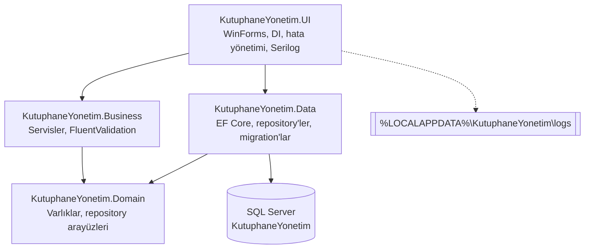
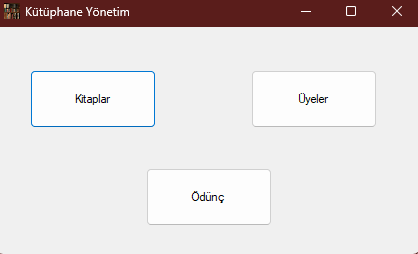
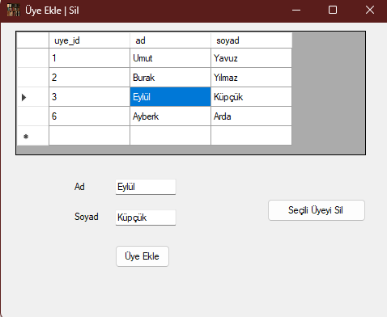

# 📚 Kütüphane Yönetim - Kütüphane Yönetim Sistemi (C# & SQL Server)

🇬🇧 [English](README.md) · 🇹🇷 **Türkçe**

.NET 10 ve SQL Server ile geliştirilmiş bir Windows Forms kütüphane yönetim uygulaması. Kitapları, üyeleri ve
ödünç işlemlerini (ödünç verme / iade, tarihleriyle birlikte) takip eder. Kod Domain, Business, Data ve UI
katmanlarına ayrılmıştır; veri erişimi EF Core ile yapılır, veritabanı açılışta otomatik olarak oluşturulur ve güncellenir.

> Uygulamanın arayüzü Türkçedir. Aşağıda ekran ve düğme adları Türkçe etiketiyle, yanında İngilizce karşılığıyla
> verilmiştir, örneğin "Ödünç" (Loans).

---

## 📦 Özellikler

- ✅ **Kitaplar** ("Kitaplar"): "Kitap Ekle | Sil" (Add | Delete Book) ekranında kitap listeleme, ekleme ve silme.
- ✅ **Üyeler** ("Üyeler"): "Üye Ekle | Sil" (Add | Delete Member) ekranında üye listeleme, ekleme ve silme.
- ✅ **Ödünç** ("Ödünç"): "Kitap Ödünç Al | İade Et" (Lend | Return Book) ekranında üyeye kitap ödünç verme
  ("Ödünç Al", Lend), iade alma ("İade Et", Return), ödünç ve iade tarihlerini görme.
- ✅ **İş kuralları**: aynı kitap aynı anda iki üyeye ödünç verilemez (işlem içinde kontrol edilir ve filtreli
  benzersiz indeksle korunur); açık ödüncü ya da ödünç geçmişi olan kitap veya üye silinemez.
- ✅ **Girdi doğrulama**: kitap adı, yazar ve üye adları kırpılır; boş olamaz ve sütun uzunluğunu aşamaz
  (kitaplar için 100, üye adları için 50 karakter). Kurallar merkezi FluentValidation doğrulayıcılarındadır.
- ✅ **Otomatik veritabanı kurulumu**: açılışta bekleyen EF Core migration'ları uygulanır; özgün uygulamanın
  oluşturduğu veritabanı verisi korunarak yerinde güncellenir.
- ✅ **Hata yönetimi ve günlük**: beklenmeyen hatalar merkezi olarak yakalanır ve kısa Türkçe mesajla gösterilir;
  teknik ayrıntılar yalnızca günlük dosyasına yazılır.

---

## 🧰 Teknolojiler

| Alan | Kullanılan |
|---|---|
| Platform | .NET 10 (`net10.0-windows` UI, `net10.0` kütüphaneler) |
| Arayüz | Windows Forms |
| Veri erişimi | Entity Framework Core 10 (SQL Server sağlayıcısı) |
| Veritabanı | Microsoft SQL Server (Express veya LocalDB yeterli) |
| Doğrulama | FluentValidation |
| Yapılandırma / DI | Microsoft.Extensions.Configuration (JSON, user secrets, ortam değişkenleri), Microsoft.Extensions.DependencyInjection |
| Günlük | Serilog (dosya, günlük rotasyon) |
| Test | xUnit v3, Moq, EF Core SQLite (bellek içi), isteğe bağlı gerçek SQL Server testi |
| CI | GitHub Actions (`.github/workflows/ci.yml`) |

---

## 🗂️ Proje Yapısı

```text
KutuphaneYonetim/
├── src/
│   ├── KutuphaneYonetim.Domain/     # Varlıklar (Book, Member, Loan, LoanDetail) ve repository arayüzleri
│   ├── KutuphaneYonetim.Business/   # BookService, MemberService, LoanService, Validation/ (FluentValidation)
│   ├── KutuphaneYonetim.Data/       # EF Core DbContext, yapılandırmalar, Migrations/, eski şema yükseltme, repository'ler
│   └── KutuphaneYonetim.UI/         # WinForms ekranları, Infrastructure/ (hata, günlük), Program.cs (bağımlılık kurulumu)
├── tests/
│   ├── KutuphaneYonetim.Business.Tests/  # Servis ve doğrulayıcı birim testleri (Moq)
│   ├── KutuphaneYonetim.Data.Tests/      # SQLite üzerinde repository ve servis testleri, eski şema testi (SQL Server)
│   └── KutuphaneYonetim.UI.Tests/        # Yapılandırma, hata mesajı ve günlük temizleme testleri
├── docs/THREAT_MODEL.md             # Tehdit modeli (İngilizce)
├── .github/workflows/ci.yml         # Derleme, test ve sürüm iş akışı
├── screenshots/                     # README ekran görüntüleri
├── CHANGELOG.md
└── KutuphaneYonetim.sln
```



UI, Data katmanına yalnızca açılışta bağımlılıkları kaydetmek için başvurur; formlar Business servisleri
üzerinden çalışır. Tüm veritabanı erişimi asenkron ve parametrelidir. Sağlayıcı DI ile (`AddDataAccess`)
yapılandırıldığı için testler SQLite bellek içi veritabanını kullanabilir.

---

## 🛠️ Kurulum ve Kullanım

### Gereksinimler

- .NET 10 SDK (Windows)
- SQL Server (Express veya LocalDB yeterli)

### 1. Yapılandırma

`Kutuphane` adlı bağlantı cümlesini aşağıdakilerden biriyle verin (sonraki öncekini ezer):

1. **`appsettings.json`**: `src/KutuphaneYonetim.UI/appsettings.example.json` dosyasını aynı klasöre
   `appsettings.json` olarak kopyalayıp `ConnectionStrings:Kutuphane` değerini düzenleyin. `appsettings.json` git'e girmez.

   ```json
   {
     "ConnectionStrings": {
       "Kutuphane": "Server=localhost\\SQLEXPRESS;Database=KutuphaneYonetim;Trusted_Connection=True;TrustServerCertificate=True;"
     }
   }
   ```

2. **User secrets**:

   ```powershell
   dotnet user-secrets set "ConnectionStrings:Kutuphane" "<bağlantı cümlesi>" --project src/KutuphaneYonetim.UI
   ```

3. **Ortam değişkeni** `ConnectionStrings__Kutuphane`.
4. **Ortam değişkeni** `KUTUPHANE_CONNECTION` (en yüksek öncelik).

> JSON içinde `localhost\SQLEXPRESS` ifadesindeki `\` karakteri `\\` olarak yazılır. `TrustServerCertificate=True`
> yalnızca yerel geliştirme sunucusu içindir.

Bağlantı cümlesi bulunamazsa uygulama bu seçenekleri anlatan Türkçe bir mesaj gösterip kapanır.

### 2. Çalıştırma

```powershell
dotnet build -c Release
dotnet run --project src/KutuphaneYonetim.UI
```

İlk açılışta veritabanı oluşturulur ve örnek verilerle doldurulur; bekleyen migration'lar her açılışta otomatik
uygulanır, elle `dotnet ef database update` çalıştırmak gerekmez.

### 3. Migration'lar

```powershell
dotnet tool restore
dotnet ef migrations list --project src/KutuphaneYonetim.Data
dotnet ef migrations add <Ad> --project src/KutuphaneYonetim.Data --output-dir Persistence/Migrations
```

Tasarım zamanı fabrikası `KUTUPHANE_CONNECTION` değişkenini okur, yoksa yerel SQL Server Express örneğini kullanır.

### 4. Günlükler

Günlükler `%LOCALAPPDATA%\KutuphaneYonetim\logs\kutuphane-YYYYMMDD.log` dosyalarına, her gün için ayrı dosya
olarak yazılır ve son 30 dosya saklanır. Klasör deponun dışındadır. İstisna mesajları günlüğe yazılmaz
(kullanıcının girdiği değerleri içerebilir); yalnızca istisna türleri, hata kodları ve yığın izleri yazılır.
Üye adları ve diğer kişisel veriler hiçbir zaman günlüğe girmez.

---

## 🔐 Güvenlik

Tehdit modeli için [docs/THREAT_MODEL.md](docs/THREAT_MODEL.md) dosyasına bakın.

- Bağlantı cümleleri depo dışında tutulur (`appsettings.json` yok sayılır; user secrets ve ortam değişkenleri desteklenir).
- Tüm sorgular EF Core üzerinden gider; kullanıcı girdisiyle elle oluşturulan SQL yoktur.
- İş kuralları Business katmanında uygulanır ve veritabanı kısıtlarıyla desteklenir (silmeyi kısıtlayan yabancı
  anahtarlar, iade tarihi kontrol kısıtı, açık ödünçler için filtreli benzersiz indeks).
- Kullanıcı yalnızca Türkçe mesaj görür; ham istisna metni hiçbir zaman gösterilmez.
- Uygulamada oturum açma veya rol yoktur: uygulamayı başlatabilen herkes tüm verileri değiştirebilir. Veritabanı
  erişimi bağlantı cümlesindeki SQL Server hesabıyla sınırlanır.

---

## 🖥️ Ekran Görüntüleri

| "Kütüphane Yönetim" (Main menu) | "Kitap Ekle \| Sil" (Books) |
| --- | --- |
|  |  |

| "Kitap Ödünç Al \| İade Et" (Loans) | "Üye Ekle \| Sil" (Members) |
| --- | --- |
|  |  |

---

## 🧪 Test

### Elle test

1. "Kitaplar" (Books) ekranında kitap ekleyip silin; adı boş bir kitap eklemeyi deneyin.
2. "Üyeler" (Members) ekranında üye ekleyip silin.
3. "Ödünç" (Loans) ekranında bir kitabı ödünç verip iade alın; tablodaki tarihleri kontrol edin.
4. Aynı kitabı iki kez ödünç vermeyi ve kitabını iade etmemiş bir üyeyi silmeyi deneyin: ikisi de uyarıyla reddedilir.
5. SQL Server'ı durdurun; anlaşılır bir Türkçe hata gösterildiğini ve ayrıntının günlük dosyasına yazıldığını kontrol edin.

### Otomatik testler

```powershell
dotnet test -c Release
```

| Proje | Tür | Kapsam | Sonuç (`-c Release`) |
|---|---|---|---|
| `tests/KutuphaneYonetim.Business.Tests` | Birim | Ödünç çakışması, iade, silme kuralları, doğrulama mesajları ve sınırlar (xUnit + Moq) | 42 başarılı |
| `tests/KutuphaneYonetim.Data.Tests` | Entegrasyon | SQLite bellek içi (`Data Source=:memory:`) üzerinde repository ve servisler; SQL Server'da eski şema yükseltme | 13 başarılı, 1 atlandı |
| `tests/KutuphaneYonetim.UI.Tests` | Birim | Örnek yapılandırma, Türkçe hata mesajları, günlük temizleme, günlük dosyası oluşturma | 8 başarılı |

Atlanan test, SQL Server gerektiren eski şema yükseltme testidir. `KUTUPHANE_TEST_SQLSERVER` değişkenindeki
sunucuda (varsayılan: Windows kimlik doğrulamalı yerel SQL Express) geçici bir veritabanı kullanır;
`KUTUPHANE_SKIP_SQL_TESTS=1` tanımlıysa ya da sunucuya ulaşılamıyorsa atlanır. Geçici veritabanı sonra silinir.

SQLite'ta şema migration yerine modelden (`EnsureCreated`) oluşturulur ve satır sürümleri üretilmez; bu yüzden
eşzamanlılık yarışları yalnızca SQL Server testiyle kapsanır.

---

## 🚀 CI ve Sürüm

`.github/workflows/ci.yml`, `main` dalına her push'ta, pull request'lerde ve `v*` etiketlerinde çalışır (Windows, .NET 10):

1. **Derleme:** `dotnet build -c Release`
2. **Test:** `dotnet test -c Release` (SQL Server testi atlanır)
3. **Sürüm (yalnızca `v*` etiketlerinde):** çatıya bağlı (framework-dependent) win-x64 çıktısı yayımlanır ve
   `KutuphaneYonetim-<etiket>-win-x64.zip` iş akışı çıktısı (artifact) olarak yüklenir

Aynı çıktıyı yerelde üretmek için:

```powershell
dotnet publish src/KutuphaneYonetim.UI -c Release -r win-x64 --self-contained false -o ./publish
```

Hedef makinede .NET 10 Desktop Runtime kurulu olmalıdır. `appsettings.json` dosyasını `KutuphaneYonetim.exe`
yanına koyun ya da `KUTUPHANE_CONNECTION` değişkenini tanımlayın.

---

## 👨‍💻 Geliştirici Notları

- Sürüm geçmişi için [CHANGELOG.tr.md](CHANGELOG.tr.md) dosyasına bakın.
- `Program.cs` bağımlılıkların kurulduğu yerdir: yapılandırma, DI, günlük ve genel `ThreadException` /
  `UnhandledException` işleyicileri burada hazırlanır.
- İş kuralı ihlalleri Türkçe mesajlı `BusinessRuleException` fırlatır; arayüz bunu uyarı olarak gösterir.
- Doğrulayıcılar (`BookInputValidator`, `MemberInputValidator`, `LoanInputValidator`)
  `KutuphaneYonetim.Business/Validation` klasöründedir ve ilk hatada durur; kullanıcı her seferinde tek mesaj görür.

---

## 🧳 Lisans

Kişisel ve eğitimsel kullanım için ücretsizdir. Ticari amaçla kullanılması uygun değildir.
